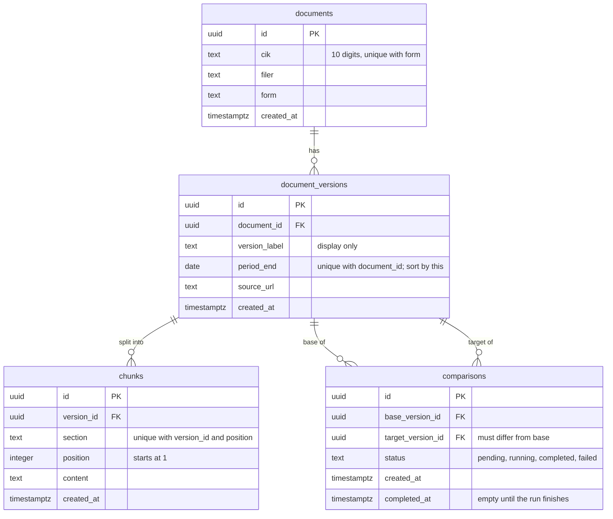

# Schema

A document is one company's recurring filing. Each filing for one
reporting period is a version of it, each version is split into chunks of text, and a comparison
runs between two versions of the same document.

## Delete rules

Cascade what can be regenerated, restrict what represents work.

- `chunks.version_id` → `document_versions`: **CASCADE**. Re-ingesting a filing rebuilds its chunks.
- `document_versions.document_id` → `documents`: **RESTRICT**. A document cannot be deleted while it
  has versions.
- `comparisons.base_version_id` and `target_version_id` → `document_versions`: **RESTRICT**. A
  comparison's result cost model calls, so a version in use cannot be deleted; the API returns 409.

"Same document" for a comparison spans two rows, so no constraint can enforce it; the API does.
